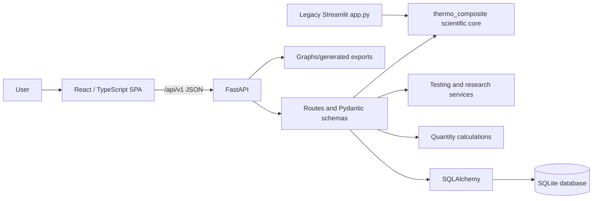
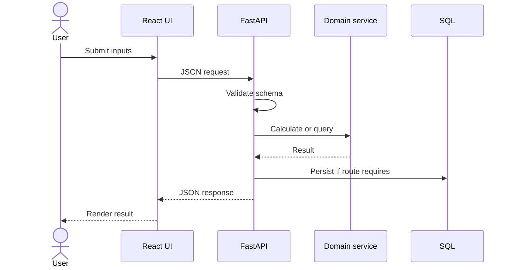

# 03 — System Architecture

The primary frontend calls FastAPI. In development Vite proxies `/api/v1` to the local backend. FastAPI validates requests, dispatches route services and persists simulations, usage transactions, and research records through SQLAlchemy. Domain code is separated into scientific, testing, quantity, and thermal-analysis modules. Thermal export writes SVG/CSV/JSON artifacts. Streamlit remains a separate legacy caller of the scientific core.

The research parser is not connected to an upload/persistence API. Auth helpers are not middleware. There is no background job queue. See [API](10_API_Documentation.md) and [module status](04_Module_By_Module_Documentation.md).
