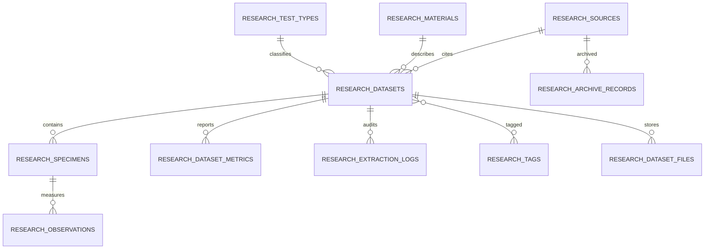

# 09 — Database Schema and ERD

SQLAlchemy models and Alembic migrations live under `backend/`. Startup initializes application tables and applies migrations. SQLite is the observed local database; PostgreSQL driver/dialect support is declared but no live PostgreSQL service was verified. SQLite foreign keys are enabled.

The 12 research tables are `research_sources`, `research_materials`, `research_test_types`, `research_datasets`, `research_specimens`, `research_observations`, `research_dataset_metrics`, `research_extraction_logs`, `research_tags`, `research_dataset_tags`, `research_dataset_files`, and `research_archive_records`. Application tables include `simulation_records` and `material_usage_transactions`. Exact columns/constraints are defined by models and migrations. Snapshot counts: 34 sources, six archive entries, zero datasets, zero observations. Migration revision observed: `20261114_04`.
